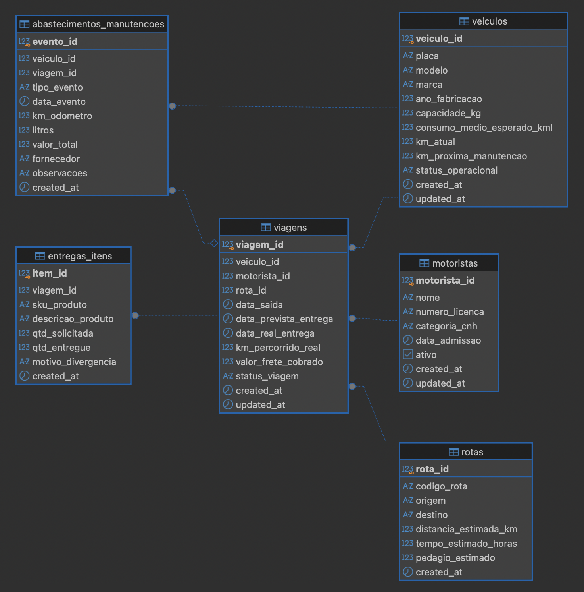
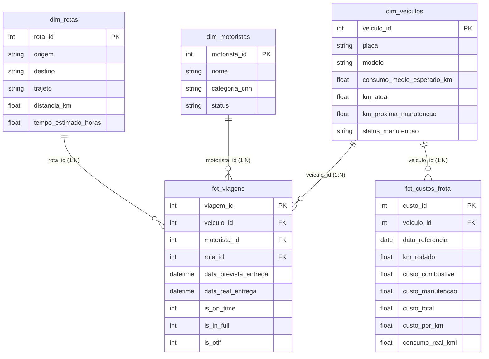
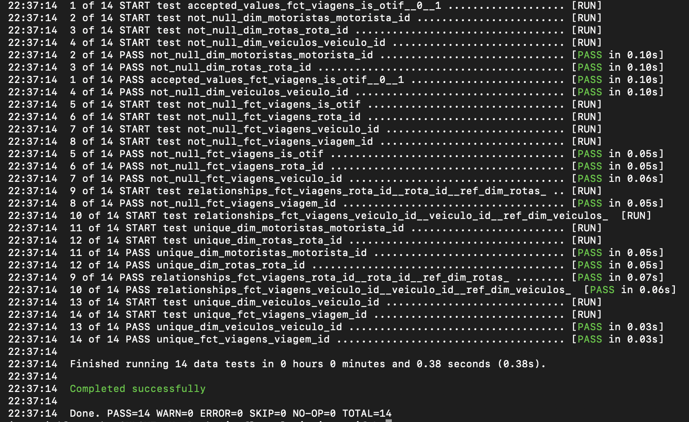
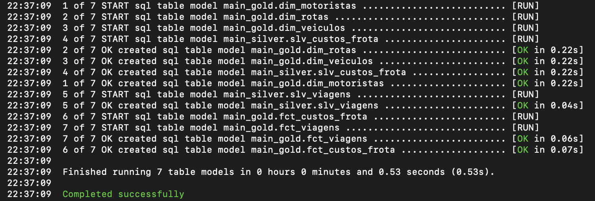
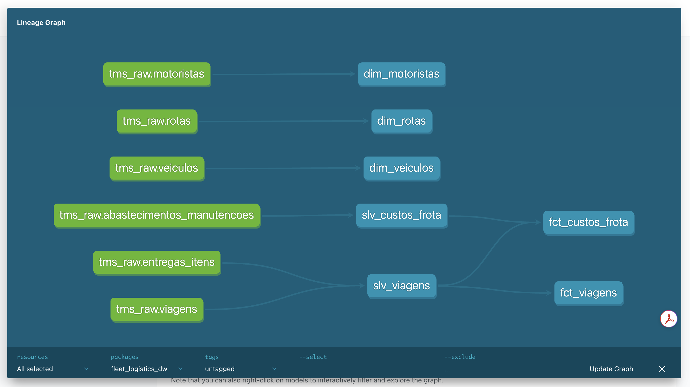
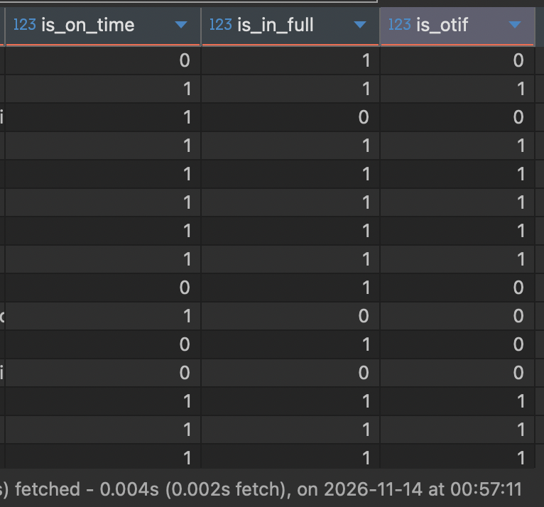
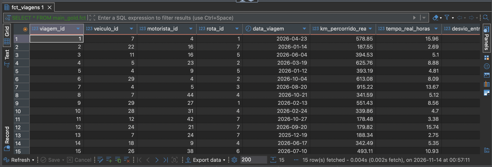

# Sistema de Gestão de Frotas e Logística (OTIF & Custo de Frete)


Pipeline **End-to-End de Engenharia e Análise de Dados** desenvolvido para monitorar a operação e a eficiência financeira de frotas rodoviárias. O projeto transforma registos transacionais de transporte num Data Warehouse analítico sob a **Arquitetura Medalhão**, automatizando o cálculo do indicador **OTIF (On-Time In-Full)**, o rastreamento de **Custo por KM rodado** e alertas preventivos de **Manutenção**.

---

## 1. Problemática de Negócio
Empresas de transporte e distribuição sofrem perdas financeiras significativas causadas por:
- **Quebras de SLA (Baixo OTIF):** Atrasos nas entregas e divergências de quantidade (entregas parciais ou avariadas) sem visibilidade por rota ou motorista.
- **Desvio de Consumo de Combustível:** Veículos operando acima do consumo médio esperado (km/l) sem alertas operacionais.
- **Manutenções Corretivas Emergenciais:** Ausência de monitoramento preventivo baseado na quilometragem atual vs. limite de revisão.

---

## 2. Arquitetura da Solução & Fluxo de Dados

```text
┌───────────────────────────┐
│   PostgreSQL (OLTP/TMS)   │  6 tabelas normalizadas (3.000+ viagens, cargas, frota)
└─────────────┬─────────────┘
              │  Extração Idempotente (Python + Pandas)
              ▼
┌───────────────────────────┐
│   DuckDB - Camada Bronze  │  Schema: raw (dados brutos + metadado _extracted_at)
└─────────────┬─────────────┘
              │  Limpeza & Regras de Negócio (dbt Core)
              ▼
┌───────────────────────────┐
│   DuckDB - Camada Silver  │  Schema: main_silver (flags is_on_time, is_in_full)
└─────────────┬─────────────┘
              │  Modelagem Star Schema & Data Quality Tests (dbt Core)
              ▼
┌───────────────────────────┐
│   DuckDB - Camada Gold    │  Schema: main_gold (3 Dimensões + 2 Tabelas Fato)
└─────────────┬─────────────┘
              │  Exportação Parquet & Orquestração Diária (Apache Airflow)
              ▼
┌───────────────────────────┐
│     Power BI Dashboard    │  KPIs Executivos: OTIF, Custo/KM e Semáforo Manutenção
└───────────────────────────┘
```

### Modelo Entidade-Relacionamento (Origem OLTP - PostgreSQL)


### Modelagem Dimensional (Camada Gold - Star Schema)
- **`fct_viagens`**: Granularidade por viagem; consolida lead time real, desvio de entrega (horas), `is_on_time`, `is_in_full` e `is_otif`.
- **`fct_custos_frota`**: Granularidade diária por veículo; consolida receita de frete, custos de combustível e manutenção, `custo_por_km` e `consumo_real_kml`.
- **`dim_veiculos`**: Cadastro da frota, consumo esperado (km/l) e regra de semáforo `status_manutencao` (`Normal`, `Alerta - Próximo da Revisão`, `Crítico - Manutenção Vencida`).
- **`dim_motoristas`**: Dados cadastrais, categoria de habilitação e status operacional.
- **`dim_rotas`**: Origem, destino, trajeto formatado, distância e tempo estimado.



---

## 3. Qualidade de Dados e Requisitos Não Funcionais
- **Integridade Referencial & Unicidade:** Validada via testes automatizados do dbt (`unique`, `not_null`, `relationships` e `accepted_values` em todas as chaves primárias, estrangeiras e flags binárias).
- **Resiliência:** Pipeline orquestrado no Apache Airflow (`fleet_logistics_otif_daily`) configurado com `retries=3`, `retry_delay=2min` e idempotência na camada Bronze (`CREATE OR REPLACE TABLE`).
- **Performance (SLA < 15 min):** Execução completa do pipeline ETL e transformação dos 7 modelos dbt concluída em menos de 5 segundos.

---

## 4. Principais Medidas Analíticas (Power BI / DAX)

```dax
Taxa OTIF (%) = AVERAGE(fct_viagens[is_otif])

On-Time (%) = AVERAGE(fct_viagens[is_on_time])

In-Full (%) = AVERAGE(fct_viagens[is_in_full])

Custo Médio por KM = 
DIVIDE(SUM(fct_custos_frota[custo_total]), SUM(fct_custos_frota[km_rodado]), 0)

Veículos em Alerta Manutenção = 
CALCULATE(COUNTROWS(dim_veiculos), dim_veiculos[status_manutencao] <> "Normal")
```

---

## 5. Como Reproduzir o Projeto

### Pré-requisitos
- Python 3.9+ e PostgreSQL ativo na porta `5432`.

### Passo a Passo
1. **Clonar o repositório e ativar o ambiente virtual:**
   ```bash
   git clone [https://github.com/kloutruben/fleet-logistics-otif.git](https://github.com/kloutruben/fleet-logistics-otif.git)
   cd fleet-logistics-otif
   python3 -m venv .venv
   source .venv/bin/activate
   pip install pandas psycopg2-binary duckdb dbt-duckdb faker python-dotenv apache-airflow
   ```

2. **Configurar variáveis de ambiente (`.env`):**
   ```env
   DB_HOST=localhost
   DB_PORT=5432
   DB_NAME=tms_db
   DB_USER=postgres
   DB_PASS=postgres
   ```

3. **Inicializar o banco transacional PostgreSQL e gerar massa de dados:**
   Execute `postgres/init/01_schema.sql` na base `tms_db` e rode o gerador sintético:
   ```bash
   python scripts/generate_tms_data.py
   ```

4. **Executar o Pipeline Completo via Apache Airflow:**
   ```bash
   export AIRFLOW_HOME=$(pwd)/airflow
   export OBJC_DISABLE_INITIALIZE_FORK_SAFETY=YES
   airflow dags test fleet_logistics_otif_daily
   ```
   Os ficheiros otimizados para BI serão exportados automaticamente para `data/gold_export/*.parquet`.

---

## 6. Evidências de Execução (Logs & Data Warehouse)

### Transformação e Testes de Qualidade (`dbt build`)



### Orquestração End-to-End (`Apache Airflow`)


### Camada Gold no Data Warehouse (`DuckDB`)



---

## 7. Implementações Futuras (Roadmap)
- [ ] **Machine Learning (`Scikit-Learn`):** Modelo de classificação para prever a probabilidade de atraso por rota, veículo e motorista antes do despacho.
- [ ] **Streaming em Tempo Real (`Apache Kafka`):** Ingestão de telemetria GPS para cálculo dinâmico de ETA e alertas instantâneos de desvio de rota.
